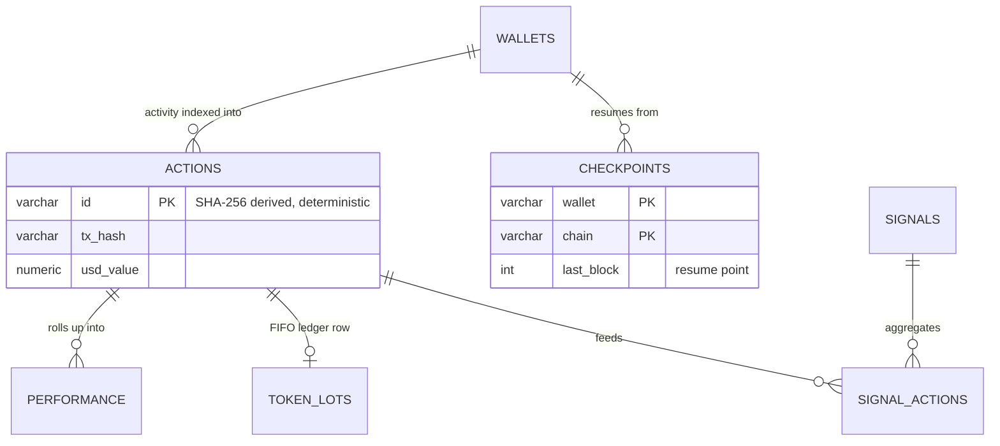
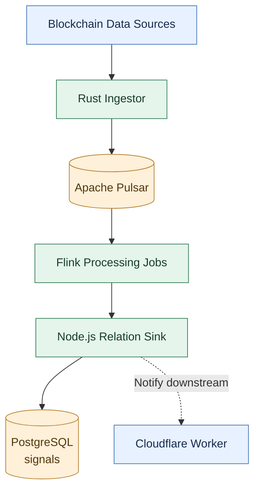
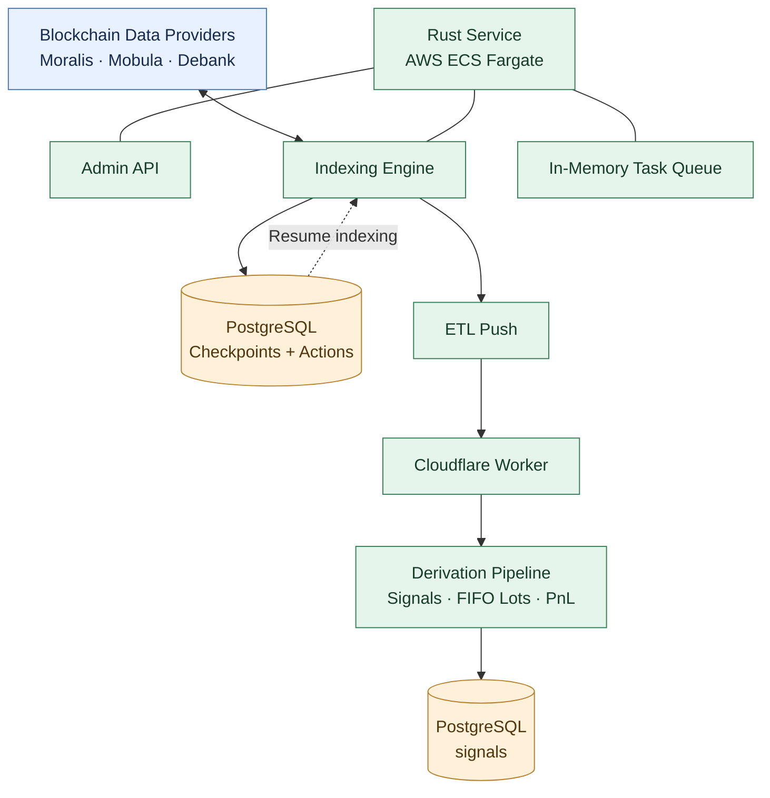
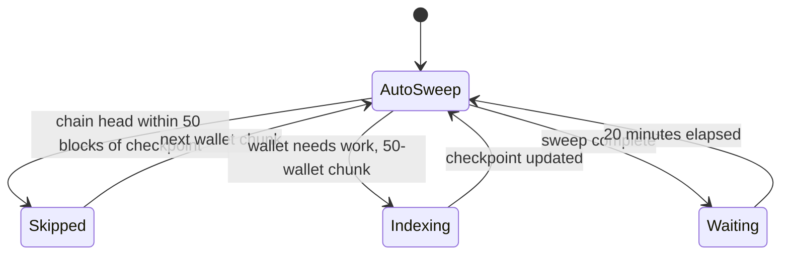
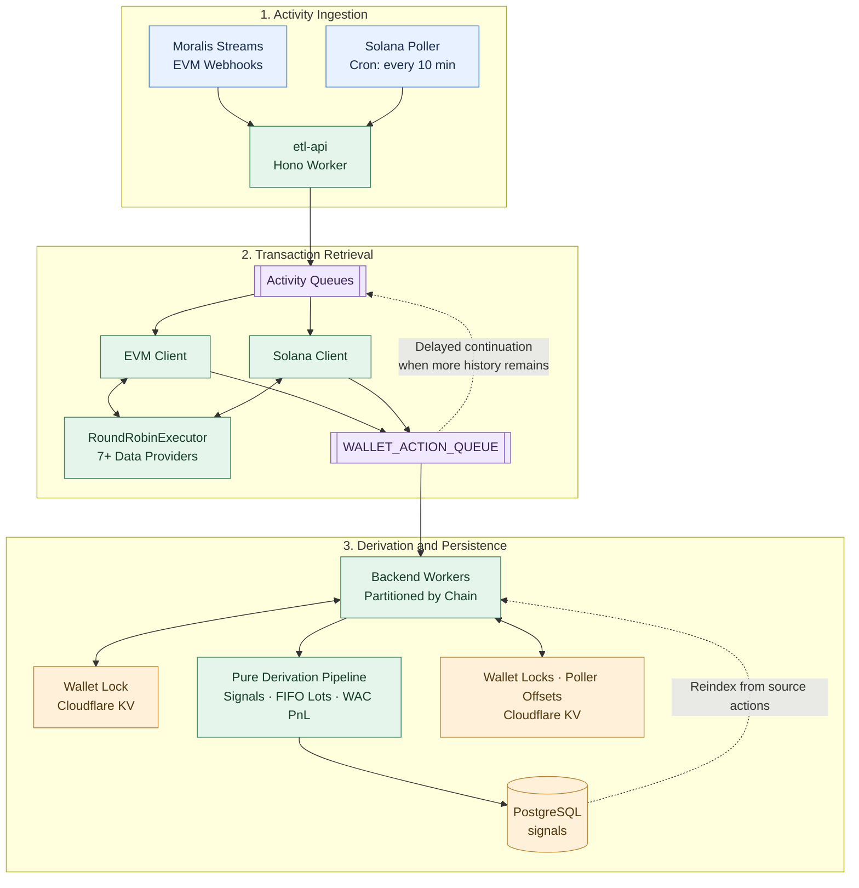
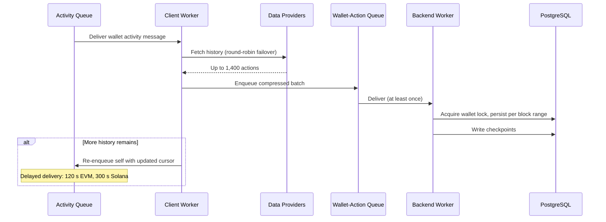

_An engineering retrospective on rebuilding a DeFi data platform, from Pulsar and Flink to Rust services and Cloudflare Workers, while keeping the underlying data model stable._

MC² Finance provides analytics for cryptocurrency portfolios across EVM-compatible blockchains and Solana. The platform indexes wallet activity, normalizes transactions, identifies buys, sells and swaps, and calculates portfolio performance, including realized profit and loss.

The data pipeline behind these features has to handle more than just transaction volume. Blockchain data comes from external providers with different APIs, rate limits and failure modes. Historical indexing can involve thousands of transactions for a single wallet, while active wallets continue generating new activity. The system must also recover from interrupted jobs without duplicating transactions or corrupting portfolio calculations.

Throughout the years, we evolved the ingestion architecture through three generations. We started with a Pulsar and Flink pipeline, consolidated it into a Rust service running on AWS ECS, and eventually moved to an event-driven system built on Cloudflare Workers and Queues.

Each iteration changed how data moved through the system. The underlying PostgreSQL data model, however, remained largely unchanged.

This is a look at how those architectures evolved, why we replaced them, and which parts of the original design continued to serve us throughout the process.

## The data model

Before discussing the infrastructure, it helps to understand what the pipeline actually produces.

At the center of the system was a PostgreSQL schema named `signals`. It contained five principal components:

- **Actions:** Normalized transaction records representing transfers and other wallet activity, including USD values.
- **Signals:** Derived BUY, SELL and SWAP events used by the application.
- **Token lots:** A JSONB-backed ledger used to track token acquisitions and disposals under FIFO accounting.
- **Performance:** Realized gains and percentages calculated using weighted-average cost, grouped by wallet, token, chain and block.
- **Checkpoints:** The last indexed block for each wallet and chain, allowing indexing to resume after interruptions.

The relationships between those components looked like this:

Two properties of this model became particularly important as the infrastructure changed.

First, action IDs were deterministic. Both the Rust implementation and its TypeScript successor used the same ID-generation scheme, based on SHA-256 hashes of transaction identity fields and truncated to 15 hexadecimal characters. Processing the same action again therefore produced the same identifier.

This allowed the pipeline to use idempotent writes and tolerate overlapping indexing runs. A reindex could process transactions that had already been ingested without necessarily creating duplicate records.

Second, the derived data could be rebuilt from the underlying actions. Signals, token lots and performance calculations were implemented as transformations of the action records rather than independent sources of truth.

That distinction mattered later. We could discard derived state and recalculate it without changing the application-facing data model. It also gave us a practical foundation for implementing full wallet reindexing.

The schema was not entirely immutable. We made an additive migration to widen `tx_hash` to accommodate longer Solana transaction hashes. But the main tables and their relationships survived all three pipeline implementations.

## Generation 1: Pulsar and Flink

Our first implementation followed a conventional streaming architecture.

A Rust ingestor collected blockchain data and published messages to Apache Pulsar. Flink jobs processed the stream, while a Node.js service, `pulsar-message-transport`, materialized relationships between signals, actions and transaction intents into PostgreSQL. The service also notified a downstream Cloudflare Worker.

The design separated ingestion, processing and persistence into distinct components. Pulsar provided the messaging layer, and Flink gave us a framework for processing streams independently of the ingestion service.

The architecture worked, but its operational cost was higher than our workload justified.

We had relatively modest throughput and only a small number of downstream consumers. Maintaining the broker, its authentication configuration, the Flink jobs and the transport service introduced additional failure modes without delivering much practical benefit at that stage.

There were also implementation limitations. The transport service processed messages sequentially with a fixed five-second delay, limiting throughput. Its reader resumed at the latest position rather than reliably continuing from a durable checkpoint. Retries were not sufficiently bounded: database writes retried indefinitely, while downstream worker notifications were fire-and-forget, so a failed notification was simply dropped. The combination meant a database outage could wedge the consumer, while a lost notification silently skipped downstream processing.

These were not fundamental problems with Pulsar or Flink. They were problems with the way we had implemented the pipeline and the amount of infrastructure we needed to operate.

By the beginning of Q4 2024, we had removed Pulsar, the protobuf pipeline and Redis. The ingestion service wrote directly to the database and pushed work to a Cloudflare Worker.

The first architecture had helped us establish the processing boundaries, but retaining the entire streaming stack no longer made sense for the workload.

## Generation 2: A Rust service on ECS

The next implementation consolidated ingestion and orchestration into a single Rust service running on AWS ECS Fargate.

The service combined an administrative API, the indexing engine and a producer responsible for pushing data to a Cloudflare Worker for ETL processing. Actions were sorted by block number and pushed in batches of 500, and each completed wallet emitted a status message to a downstream consumer. The deployed task was configured with four vCPUs and 8 GB of memory in `eu-west-1`.
### Delegating blockchain indexing

Rather than operating archival RPC nodes for every supported chain, we relied on commercial blockchain data providers.

Moralis supplied block data and historical portfolio information, Mobula provided transaction history, and Debank supplied balance information. The pipeline integrated these services and transformed their responses into the internal action model.

This was a deliberate division of responsibility. Maintaining chain nodes would have introduced a separate infrastructure workload, while the product's main requirements lay in normalizing activity, processing wallet histories and calculating portfolio performance.

External providers brought their own limitations, particularly rate limits, timeouts and inconsistent availability. Those limitations became an important consideration in the design of the indexing engine.
### Resumable indexing

The service indexed wallets in batches of 50 and used checkpoints to track progress for each wallet and chain.

A wallet could be skipped when its chain head had not advanced sufficiently beyond its last indexed block. The implementation used a 50-block threshold as a finality buffer before starting another indexing pass.

The task queue itself was held in memory, with sweeps recurring on a twenty-minute timer. A service restart could therefore discard queued work, but the periodic indexing process could rediscover that work from the wallet records and checkpoints.

This was a reasonable trade-off for the workload: rather than introducing a durable job queue immediately, we made interrupted work recoverable through the indexing process itself.

The service also used ECS restarts to recover from panics. That simplified some failure handling, although it placed greater importance on making indexing operations safe to repeat.

### Understanding the capacity limits

We documented the expected throughput and the likely database bottleneck before attempting to scale the service further.

The architecture was designed around an estimated sustained rate of approximately 1,000 to 1,500 actions per second, with the PostgreSQL primary identified as the limiting component. The corresponding theoretical throughput was roughly 100 million actions per day, assuming sustained processing at the target rate.

We also explored a potential scaling path involving Aurora, S3-backed checkpoints and wallet-based sharding.

That plan remained a capacity model rather than a migration we had to execute. It gave us a working understanding of where additional capacity would be needed without requiring us to build for a workload we had not yet encountered.

During this period, we also added support for multiple chains, spam-token filtering and wallet blacklisting for accounts with more than 10,000 transactions. The service became the primary implementation of the indexing and data-processing workflow before we began the move to Cloudflare.

## Generation 3: Cloudflare Workers and Queues

By the end of 2024 Q4, we had a clearer picture of the workload and the boundaries between ingestion, indexing and derivation. We began replacing the Rust service with a TypeScript-based system built around Cloudflare Workers.

The new repository, `cf-ingestor`, used a Turborepo structure with six Workers and five shared packages.

The migration replaced the ECS service and its provider integrations with an event-driven pipeline using Cloudflare Queues, Workers and Hyperdrive for PostgreSQL connectivity.

The system was organized around three stages.

First, activity entered through ingestion endpoints. Moralis Streams delivered EVM wallet activity through webhooks, while a scheduled poller handled Solana wallets.

Next, client Workers retrieved and normalized transaction history. They distributed requests across multiple blockchain providers and published compressed action batches to a shared wallet-action queue.

Finally, backend Workers consumed the actions, calculated the derived data and persisted the results to the existing `signals` schema.

### Using queues for pagination and backpressure

One of the more useful patterns in the new architecture was how it handled wallets with large transaction histories.

A client Worker was limited to processing up to 1,400 actions in a run. If more history remained, it could enqueue a continuation message containing the updated block cursor, with a delivery delay of 120 seconds on EVM and 300 seconds on Solana.

The next invocation resumed from that cursor rather than attempting to process the entire wallet history in one execution.

This pattern combined pagination and pacing with the platform's built-in message delivery mechanism. It also allowed the indexing process to yield between batches instead of holding a single long-running task.

New wallets began with a bounded initial synchronization window — sixty days of history for EVM wallets and thirty for Solana — and older history could be recovered afterwards through continuation messages or a full reindex.

The Rust implementation had solved the same problem with an in-memory task queue, sweep timers and explicit wait states. Cloudflare Queues gave us a different way to implement that control flow, with less custom scheduling infrastructure.

### Separating chain workloads

Backend Workers were partitioned by their configured `ACCEPTED_CHAIN_IDS`, allowing EVM and Solana processing to run independently.

A KV-based wallet lock, with a 15-minute TTL, helped prevent overlapping indexing operations for the same wallet. Deterministic action IDs provided an additional safeguard when work overlapped despite the lock. Checkpoints themselves remained in PostgreSQL; the KV namespace held the wallet locks, the Solana poller's offsets and block caches.

This did not eliminate every possible race condition, but it reduced the need for global coordination between processing workers.

### Moving live activity to webhooks

The Rust service relied primarily on scheduled indexing to discover new activity. In the Cloudflare implementation, Moralis Streams could deliver EVM wallet activity directly to the ingestion endpoint.

That reduced the time between an on-chain event becoming available through the provider and the pipeline beginning to process it. Scheduled polling remained necessary for Solana, where the implementation relied on a cron-triggered poller that processed ten wallets per run and persisted its offset in KV.

The result was a hybrid ingestion model: push-based updates where available, scheduled polling where necessary.

### Handling provider failures

The new implementation centralized provider selection in a `RoundRobinExecutor`, rather than distributing provider-specific retry logic across the ingestion pipeline.

It supported more than seven sources, including Moralis, Mobula, Bitquery, Uniblock, Etherscan, Helius, Debank and public RPC endpoints.

The executor used a five-second timeout, up to five retries and cooldowns between attempts, alongside per-provider success statistics. This allowed the pipeline to move between providers when one was unavailable or failing requests.

Provider failures remained an operational concern, but the pipeline could handle many of them without requiring every downstream component to understand the details of individual provider APIs.

The reliability requirements were not new. The original architecture had already identified provider failover and fault tolerance as important concerns. The third generation consolidated those concerns into a shared implementation.

### Extracting the derivation logic

The migration also gave us an opportunity to separate the data-processing algorithms from their infrastructure.

Signal generation, FIFO lot calculations and weighted-average-cost PnL were extracted into a pure TypeScript package with no database dependencies. That made the calculations easier to test independently and reduced coupling between the business logic and the runtime.

The new implementation retained the same core behavior as the Rust `data_jobs` module, including a documented 2% oversell tolerance in the weighted-average-cost calculation.

We also preserved the signal-coalescing rule that combines a buy and sell involving different tokens in the same block into a single SWAP signal.

Keeping this logic independent of the Workers runtime meant it could be tested without deploying infrastructure or setting up a database.

### The cutover and the full reindex

The new pipeline was built alongside the Rust service rather than replacing it in place. The ingestion edge and the chain clients came up first, followed by the persistence tier and the pure derivation package; the Rust service was retired once the new path had absorbed its responsibilities.

Because the derived data could be rebuilt from actions, the cutover did not require a careful data migration. A dedicated fan-out worker could trigger a full reindex: it read registered wallets from PostgreSQL and re-enqueued them into the activity queues, deliberately processing one wallet at a time so the reindex would not stampede the data providers. The indexing pipelines then deleted and re-inserted each wallet's actions per block range, and the derived state was recalculated from the result.

Full reindexing was also the safety net during the transition. Any inconsistency left over from the switch could be repaired by pointing the fan-out worker at the affected wallets and letting the pipeline rebuild their state from the action records.

### Delivery guarantees and race conditions

Cloudflare Queues delivered messages at least once, so overlapping processing was expected rather than exceptional. The pipeline treated deterministic action IDs and idempotent, delete-then-insert persistence as the correctness guarantee, and the KV wallet lock as an optimization that reduced wasted work rather than a source of truth.

The lock itself was not a strict mutex — eventually consistent storage could briefly allow two workers to acquire it for the same wallet. That was an accepted trade-off: the lock reduced duplicate effort, but correctness did not depend on it.

The queue consumers also carried their own error taxonomy. Invalid payloads and unrecoverable processing errors were acknowledged and discarded, so a poison message could not loop forever, while transient failures were retried with increasing delays. No dead-letter queues or retry caps were configured at the platform level; this code-level mapping was the entire failure policy.

## What stayed the same across the rewrites

Although the infrastructure changed substantially, several parts of the system remained consistent.

**The PostgreSQL contract stayed stable.** The application continued to consume the same principal tables throughout the migration. That avoided a coordinated rewrite of the ingestion pipeline and the user-facing product.

**Actions remained the source of truth.** Because the derived state could be recalculated, reindexing did not require a separate migration or a collection of one-off repair scripts to reconstruct portfolio data.

**Checkpoints made interrupted work recoverable.** The implementation changed from a Rust service with an in-memory task queue to a message-driven system with delayed continuations, but both approaches relied on persisted indexing progress to resume work.

**Provider failures were handled at the ingestion boundary.** The implementation evolved, but provider selection, retries and timeouts remained responsibilities of the ingestion pipeline rather than the portfolio calculation logic.

These properties made the migration easier to reason about. We were changing the execution model without changing the fundamental meaning of the data.

## What we would do differently

The three generations also exposed areas where the architecture and its operational practices could have been stronger.

The first implementation introduced more infrastructure than our workload required. A broker and stream-processing framework gave us useful separation of concerns, but the operational overhead was difficult to justify with so few consumers and relatively modest traffic.

The Rust service was simpler to operate as a single deployment, but its in-memory task queue meant that recovery depended on subsequent indexing sweeps. Checkpoints made that design viable, although a durable queue would have provided stronger guarantees about when work was scheduled and retried.

The Cloudflare implementation reduced the amount of infrastructure we managed directly, but serverless execution did not remove the need for operational safeguards. No dead-letter queues or retry caps were configured on the queue consumers, and the failure policy lived entirely in application code. That worked, but it concentrated a reliability concern in the part of the system most likely to be rewritten.

These are distinct concerns from the architecture itself. Moving to managed infrastructure reduces some operational responsibilities, but it does not replace security controls, observability, reliable failure handling or documentation that stays aligned with the code.

## What the last architecture made routine

The third generation did not introduce new reliability requirements, but it changed which operations were routine.

Adding a data provider became a contained change inside the client Workers rather than a modification of the pipeline. By the end, more than seven sources sat behind the round-robin executor, and recovering from a provider outage became automatic: the executor moved between sources within a request, with retries, timeouts and cooldowns defined once in a shared implementation.

Full reindexing also became a routine operation instead of an emergency. A serialized fan-out worker could rebuild any number of wallets from source actions, and because derived state was a transformation of those actions, a reindex required no repair scripts and no coordinated migration.

That operational posture — contained changes, automatic failover, rebuildable state — was the practical payoff of the properties the first generation had established.

## Closing thoughts

The ETL pipeline evolved from a Pulsar and Flink streaming system to a Rust service on ECS and eventually to an event-driven collection of Cloudflare Workers.

Each implementation reflected a different balance between operational complexity, control over execution and the capabilities available from the hosting platform. The first gave us a conventional streaming architecture, the second consolidated the workload into a service we could operate more directly, and the third used managed queues and serverless execution to simplify scheduling and horizontal processing.

The most durable part of the design was not a particular runtime or messaging technology. It was the data contract and the processing model around it: deterministic action identities, persisted checkpoints and derived state that could be rebuilt from its source records.

Those decisions did not prevent rewrites, but they made the rewrites substantially less disruptive. The infrastructure could change while the application continued to consume the same underlying data.

For a small engineering team building a data-intensive product, that separation proved valuable. It allowed us to replace substantial parts of the system without having to redefine what the system's data meant.
