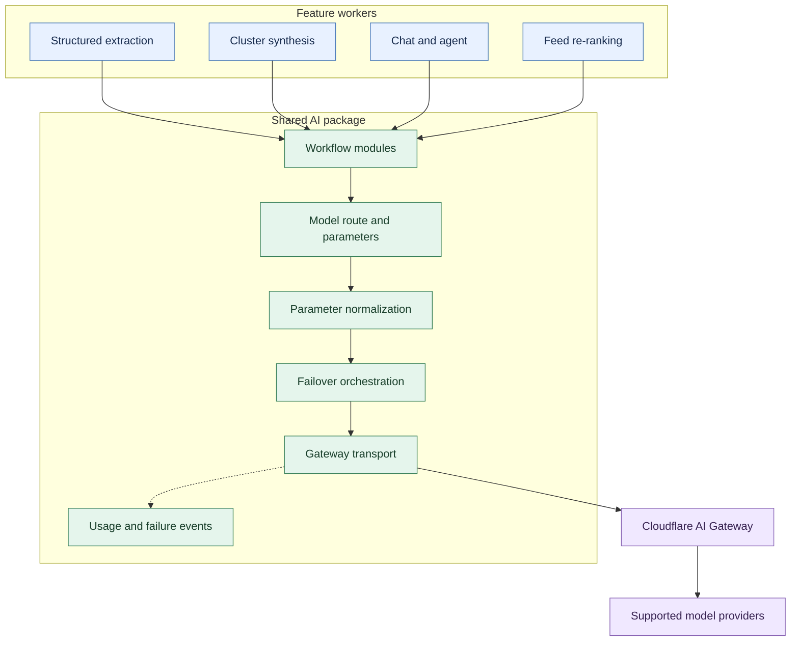
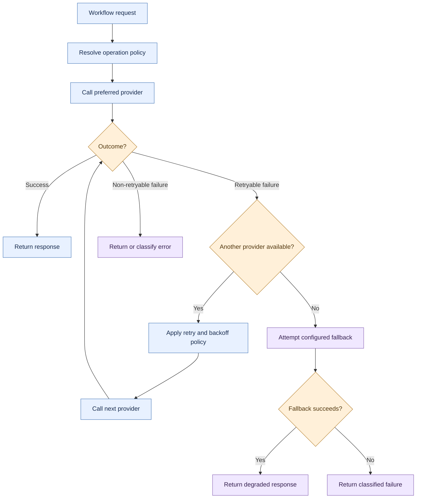
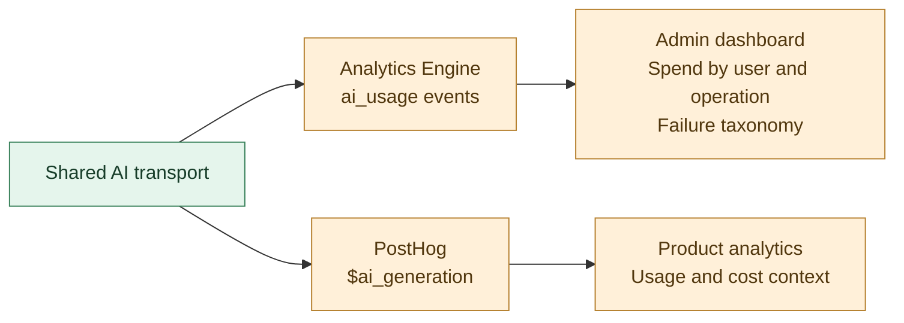
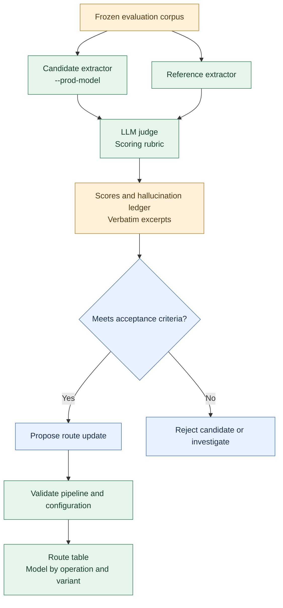

Raisolo, A news-intelligence platform that can make dozens of model calls across a single workflow: extracting facts from an article, synthesizing a multi-source storyline, re-ranking a personalized feed, or answering a question over a knowledge graph. When each feature owns its own provider integration, credentials, retries, and model choice, the complexity spreads faster than the features themselves.

We encountered two problems as the platform grew. First, model calls had no consistent boundary for credentials, failover, or per-operation cost attribution. Second, the most accuracy-sensitive stage of the pipeline relied on an informal model choice rather than a repeatable evaluation.

We addressed these problems with two architectural decisions: a shared AI workflow layer routing supported requests through a managed gateway, and a frozen evaluation set used to select models for individual pipeline stages.

The platform ingests news, newsletters, podcasts, YouTube videos, and social content. It extracts attributable claims, groups related coverage into storylines, and powers personalized feeds, daily briefings, breaking-news webhooks, and an agent API. It also generates persona-specific social posts.

Five Cloudflare Workers and six shared packages support the product, operated by a two-person team. The backend data plane was subsequently rebuilt, but the AI workflow layer remained a shared boundary across the system.

This article examines why the gateway became that boundary, how failover and usage accounting were implemented, and how evaluation results changed model routing. It also covers the costs of centralization and the failure modes the design uncovered.

## 1. The workloads behind the abstraction

The workflow layer was shaped by the variety of model workloads as much as by their volume. A structured extractor, a streaming chat endpoint, and a feed re-ranker do not have the same definition of a good response.

|Workload|What it produces|Primary constraint|
|---|---|---|
|Structured extraction|Attributed facts, quotes, opinions, and predictions|Accuracy and schema validity|
|Narrative summary|Titles, TL;DRs, and key points|Throughput and factual fidelity|
|Source research|Credibility and bias assessments|Research quality|
|Cluster synthesis|Briefings that combine coverage of the same story|Quality and coherence|
|Cluster fission|Splits sprawling clusters into coherent sub-clusters|Structural consistency|
|Feed re-ranking|Persona-specific relevance scores|Latency and ranking quality|
|Chat and agent|Streaming answers and tool calls|First-token latency and session behavior|
|Post generation|Persona-voiced social drafts and headline variations|Quality and style adherence|
|Image generation|Illustrations and sketchnotes|Image quality and cost|
|Embeddings|Vectors for semantic matching|Retrieval quality and throughput|

These workloads have different failure consequences. A hallucinated attribution can contaminate the knowledge graph and affect downstream features. A slow chat response damages an interaction immediately. A failed image-generation request may affect only an optional surface.

A single default model and a single global retry policy would force these workloads into the same trade-offs.

We grouped the operations into **workflow modules**: named operations with a model route, sampling parameters, an output-token budget, and an output parser. Feature code calls workflow modules rather than provider SDKs directly.

That boundary became the foundation for both architectural decisions described below.

## 2. From scattered SDK calls to a shared gateway

### The original design

The first implementation embedded provider calls directly in individual features. Each feature had its own client, credentials, prompts, and retry conventions.

By late Q4 2025, three problems had become difficult to ignore.

**Cost attribution was missing.** Providers billed in aggregate, but the application had no consistent per-user or per-operation usage records. Because the product had billing plans, understanding the cost of serving a particular customer was an operational requirement, not merely an analytics improvement.

**Failure handling was fragmented.** A provider outage or rate limit affected whichever features depended on that provider. Retries, where present, were implemented independently, and simultaneous workloads could amplify rate-limit pressure.

**Provider-specific parameters had leaked into feature code.** Anthropic's 4.x models rejected `temperature` in the affected request configurations, while newer OpenAI reasoning models required different completion-token parameters and did not behave like conventional chat models. Features accumulated individual workarounds, and those workarounds began to diverge.

None of these problems required a new product feature. They required a shared place to enforce integration policy.

### The alternatives

Three architectures were considered.

**Keep direct SDK calls and improve each feature.**

This preserved local control but retained duplicated credentials management, retry logic, parameter normalization, and metering. Every new feature would add another integration to maintain.

**Build an internal AI facade.**

A self-hosted service could centralize provider credentials, retries, and usage accounting. However, correct failover requires careful error classification, backoff behavior, streaming cancellation, and request-lifecycle management. Building and operating that service would create another permanent system for a small team to maintain.

**Use a managed gateway with centralized provider-key management.**

Cloudflare AI Gateway could sit between the Workers and supported providers. Provider credentials could be configured at the gateway boundary, while application code used gateway authentication. Request metadata and usage analytics could follow the same path.

We chose the third option.

The trade-off was explicit: less provider independence in exchange for not building and operating our own gateway. The gateway became part of the request path, and the application accepted that dependency where the operational benefits justified it.

This was not a claim that a managed gateway eliminates integration complexity. It moved a meaningful portion of that complexity behind a shared boundary.

### The resulting request path

The resulting architecture separated feature behavior from provider execution.

The application owns workflow semantics, route selection, parameter normalization, and any failover policy implemented in the shared package. The gateway provides the managed provider-access boundary. Usage events originate from the shared execution path rather than being independently reconstructed by each feature.

The distinction matters: centralizing requests does not automatically centralize every responsibility. The application still has to decide what to request, which failures justify another attempt, and when to stop.

### The transport details

Centralized provider-key management introduced an integration mismatch.

Provider SDKs generally expect an API key at construction time and attach it to outgoing requests through an authorization header. In our gateway configuration, the worker needed to authenticate with the gateway rather than forward a provider credential.

We implemented a custom fetch wrapper that intercepted the SDK request, removed its provider authorization header, attached the gateway authentication headers, and added request metadata.

The metadata identified the user and operation. It was restricted to the gateway's supported limit of five scalar fields.

The SDK still required an API key to construct its client. We therefore passed a sentinel value named `byok-gateway-managed` solely to satisfy SDK validation. The custom transport ensured that this sentinel was never sent as a provider credential.

The sentinel is an implementation workaround, not a security boundary by itself. The meaningful invariant is enforced by the transport: **provider credentials must not originate in feature code or be forwarded from the SDK request to the gateway.**

This reduced the number of places where provider credentials could be exposed and centralized the provider-key management boundary. The gateway authentication token remained a secret that still required appropriate protection.

The same wrapper handled provider-specific parameter normalization. For the affected models, that meant translating completion-token settings to the appropriate API field, respecting the reasoning-model token budget, and omitting unsupported sampling parameters.

The architectural rule was straightforward: a provider-specific parameter quirk should be fixed once in the shared integration layer, not rediscovered independently by every feature.

### What remained outside the gateway

Two direct-call exceptions survived the migration:

- **Video transcription**, where large payloads made the gateway path impractical.
- **Image generation**, which targeted a provider not routed through the gateway.

Each exception was documented at its call site, with a comment explaining why it bypassed the shared transport.

This distinction was important. The architecture did not require every AI-related operation to use the gateway regardless of cost or feasibility. It required every exception to be explicit rather than allowing direct provider calls to proliferate unnoticed.

## 3. Failover as a workload-specific policy

Our first failure policy used a single global provider chain. It tried a preferred provider, then fell back through a fixed ranking for selected rate-limit, server, and authentication failures.

That design was too coarse.

Extraction and synthesis are largely machine-to-machine workloads that can tolerate additional latency when quality matters. Chat and streaming are user-facing workloads in which waiting for several failed attempts can make a response unusable.

A chain optimized for reasoning quality can hurt chat latency. A chain optimized for first-token latency can compromise extraction quality.

We replaced the global ranking with **per-operation-class routing policies**.

The policy differed by workload:

- **General reasoning:** lead with a provider chosen for reasoning quality, followed by alternatives.
- **Structured extraction:** lead with the model selected through the evaluation process described in the next section.
- **Streaming chat:** order alternatives by observed first-token latency, subject to acceptable output quality.

When the configured chain was exhausted, the system could attempt a small instruct model served through Workers AI to preserve a degraded response path. This fallback traded output quality for availability.

That fallback has an important limitation: it only protects against failures that the fallback path does not share. If it depends on the same unavailable gateway, it cannot provide independent gateway-failure protection. The actual execution path must be considered separately from the provider chain.

### Failure classification before retry

Not every failed request deserves another provider attempt.

A rate limit, a transient server error, an invalid request, an exhausted context window, and a malformed JSON response represent different problems. Retrying them indiscriminately wastes time and can make an incident worse.

The shared layer classified failures before applying the retry policy. Classification tags such as `openai_length`, `anthropic_429`, and `json_parse` were propagated to the admin dashboard.

This also separated availability failures from quality failures. A token-limit truncation can return an apparently successful response while omitting part of the required output. A JSON parse failure may expose a defect in the prompt, schema, or parser rather than a provider outage.

Grouping events by classified failure made the dashboard more useful for a small team without a dedicated on-call rotation. Instead of seeing a collection of failed requests, we could distinguish recurring provider errors from integration defects and output-quality problems.

The design still required careful retry limits, timeouts, and cancellation behavior. Centralization made those policies consistent; it did not make every retry safe.

## 4. Cost attribution by construction

Once model calls passed through a shared transport, usage tracking became a property of execution rather than an optional feature-level responsibility.

Each call emitted a typed `ai_usage` event to Cloudflare Analytics Engine containing:

- User and operation identifiers.
- Model identity.
- Input and output token counts, where available.
- An estimated cost calculated from a maintained price table.
- Failure information where applicable.

The same general usage shape was sent to PostHog as `$ai_generation` events, allowing AI cost estimates to be examined alongside product activity.

The admin dashboard queried per-user and per-operation usage from Analytics Engine. The result was a consistent way to investigate which customers or workflows were driving estimated spend and whether a routing change affected the cost profile.

The cost figures were estimates, not invoice reconciliation. They depended on a maintained price table and the usage information available to the application. Provider billing rules, cached tokens, model-version changes, and other pricing details could create differences between estimates and actual invoices.

That distinction was deliberate. The dashboard was designed for operational questions: which operation is anomalously expensive, did a model change affect spend, and where should an engineer investigate? It was not intended to replace provider invoices as the accounting source of truth.

Analytics Engine retention was bounded at 90 days, with queries performed through GraphQL. This kept the operational analytics layer lightweight, but it also limited long-horizon analysis unless data was exported or retained elsewhere.

The practical difference was simple: a billing question could be answered with a dashboard query instead of reconstructing calls across multiple features.

## 5. Turning model selection into an evaluation loop

The gateway made execution more uniform, but it did not make model selection correct.

The structured-extraction stage remained the most consequential example. Its outputs fed the knowledge graph, and downstream features inherited errors introduced at extraction time. The production model had been chosen largely because it had performed adequately in previous informal checks.

We needed a repeatable way to compare candidates.

During the subsequent backend-rebuild phase, we introduced an evaluation loop built around a frozen corpus and a single model-selection parameter.

### The evaluation design

The loop had three main components.

**A frozen evaluation set.** A fixed corpus of representative documents was reused across candidate runs. Articles and transcripts were evaluated as separate variants because they have different linguistic characteristics and failure modes.

**A candidate and a reference extractor.** The production candidate generated the output under evaluation. A frontier-class reference model provided a comparison point, helping us inspect differences in coverage and extraction behavior.

**An LLM judge and a hallucination ledger.** A separate frontier model evaluated outputs against the scoring rubric. The evaluation covered fact recall and precision, quote integrity, prediction completeness, and classification fidelity. It also recorded observed hallucinations with verbatim excerpts for inspection.

The reference extractor was not treated as ground truth. It was another model output, useful for comparison but capable of omissions and errors itself.

The `--prod-model` flag made the candidate configurable from the command line rather than requiring a code change for every experiment. That small interface change lowered the cost of repeated evaluations, which was essential: a single comparison can be informative, but a repeatable loop is what makes model selection operational.

The evaluation process produced a route table keyed by operation and document variant. Workflow modules resolved their configured model at call time, separating model selection from feature implementation.

The distinction between evaluating a candidate and promoting it mattered. Evaluation results informed the route decision; they did not make an LLM judge infallible or remove the need to investigate surprising results.

### What the results changed

The evaluation did not identify one universal winner.

On the article variant of the frozen corpus, one small model from an open-model provider produced zero observed hallucinated facts, while a popular fast Anthropic small model produced eight. On the transcript variant, the Anthropic model performed better.

The result led to a per-variant routing strategy instead of a single default for all extraction.

These counts describe the observed evaluation results, not universal hallucination rates. Their significance depends on the corpus size, the facts evaluated, and the reliability of the scoring procedure. Zero observed errors on a finite test set does not establish zero risk in production.

The broader lesson was more useful than the ranking itself: articles and transcribed speech are different input distributions. A model that handles one well may struggle with the other, and model routing can reflect that difference without changing feature code.

### The evaluation also found a pipeline defect

The most consequential finding was not a model comparison.

The extraction stage's output-token cap had been set generously, but long documents were still being truncated. The model response could end partway through a fact set without producing an explicit pipeline error. The visible symptom was lower recall on longer documents.

We increased the completion cap from 2,048 to 8,192 tokens and treated score regression after a non-model change as a potential pipeline defect rather than automatically attributing it to evaluation noise.

This is where the evaluation loop became more than a model leaderboard. It tested the behavior of the configured extraction pipeline, including the effects of output budgets and surrounding implementation choices.

### What makes the evaluation trustworthy?

A frozen corpus controls one source of variation: the examples being compared. It does not, by itself, guarantee a reliable metric.

The judge, rubric, prompt, model version, and scoring configuration can also affect results. A judge may miss hallucinations, favor a particular writing style, or score ambiguous claims inconsistently.

The evaluation should therefore be interpreted as a controlled comparison under a defined scoring procedure, not as an absolute measurement of truth.

The next layer of rigor would include independently verified labels for a representative subset, judge-agreement checks, and a separate holdout set for validating changes after repeated tuning. Those safeguards help distinguish a genuinely better model from one that merely fits the evaluation corpus.

The same principle applies to model versions: comparisons should record the exact model identifier and configuration, and results should be rerun when a judge or rubric changes materially.

## 6. What stayed stable, and what it cost

The gateway and the evaluation loop addressed different concerns, but their value came from the boundaries they established together.

**Workflow policy stayed separate from feature code.** Features invoked named operations. They did not independently decide which provider SDK to construct or which credentials to use.

**Credentials stayed at the integration boundary.** Provider keys were configured at the gateway, while Workers authenticated to that boundary. Direct-call exceptions remained explicitly documented.

**Model routes became data.** The route table mapped operations and variants to model configurations, allowing routing changes without rewriting feature logic.

**Quality claims required evidence.** The frozen evaluation set made candidate comparisons repeatable and gave the team a way to detect regressions in the model and the surrounding pipeline.

These boundaries also had costs.

### Centralization concentrated failure risk

The gateway transport became a shared dependency. The BYOK-related header mismatch took days to debug, and a defect in the transport could affect every feature that used it.

The same centralization that eliminated duplicated integration logic increased the impact of a shared defect. The transport therefore deserved focused testing and clear observability.

### The fallback sacrificed quality for availability

A small fallback model could preserve a degraded response path after a provider chain was exhausted. It could not guarantee that the degraded answer was suitable for every workload.

For accuracy-critical extraction, returning a low-confidence or incomplete answer may be worse than failing explicitly. Fallback behavior should therefore reflect the operation's requirements, and downstream consumers should be able to distinguish degraded results from normal ones.

### The gateway remained a dependency

Provider access, key management, and part of the usage path depended on the managed gateway. This was the central architectural trade-off, not an incidental implementation detail.

A provider chain does not provide gateway-level resilience if every attempt relies on the same unavailable gateway. Independent fallback would require a separate path and its own security, accounting, and operational policies.

### The evaluation depended on its scoring system

An LLM judge can make comparisons cheaper and more repeatable, but it can also introduce systematic bias. A frozen corpus can lose its value as a measure of generalization if it becomes the target of repeated tuning.

Periodic review, judge calibration, and an independent holdout set are ways to preserve confidence in the evaluation rather than assuming that a single score settles the question.

### Cost analytics had a limited horizon

The 90-day retention window made operational queries useful and inexpensive, but bounded retention also bounded long-term analysis. If multi-quarter cost trends or audit requirements became important, the data would need a longer-lived destination.

These were accepted trade-offs for the scale and operating model of the system. They remain constraints to account for as the platform grows.

## 7. What became routine

The gateway did not expand the platform's capabilities by itself. It reduced the amount of duplicated work required to operate those capabilities.

Adding or evaluating a model became a configuration change and a CLI invocation rather than a series of feature-level SDK edits. Investigating estimated AI spend became a query rather than a reconstruction exercise. Provider failures could be classified and handled through shared policy instead of relying on each feature to reinvent retries.

The evaluation loop also changed the discussion around model selection. Rather than debating which model appeared better in an isolated example, the team could compare outputs against the same corpus and inspect the actual failure cases.

Neither mechanism removed the need for engineering judgment. The gateway still required correct transport behavior and explicit failure policies. The evaluation still required a trustworthy rubric and careful interpretation of its results.

What changed was where that judgment was applied: in shared policies and repeatable experiments rather than scattered integrations and informal checks.

## Closing thoughts

The gateway and the evaluation loop solved different problems. The gateway made execution consistent: credentials, parameter normalization, failover, and usage accounting moved behind a shared boundary. The evaluation loop made model selection repeatable: routes could change based on measured performance rather than whichever model had looked best in an informal test.

Neither decision removed complexity. The gateway concentrated dependency and failure risk. The evaluation loop introduced its own assumptions about corpora, judges, and scoring. What changed was where those problems lived and how consistently the team could reason about them.

For a two-person team, that distinction mattered. Adding a model no longer required modifying feature-level provider integrations. Investigating AI spend no longer required reconstructing calls across the codebase. And an extraction-model change could be evaluated against a fixed corpus before it altered the knowledge graph.

The durable part of the design was not a particular provider or gateway. It was the separation of workflow policy from feature code, execution from model selection, and measured evidence from engineering intuition. Those boundaries made the AI layer easier to change without requiring every feature to change with it.