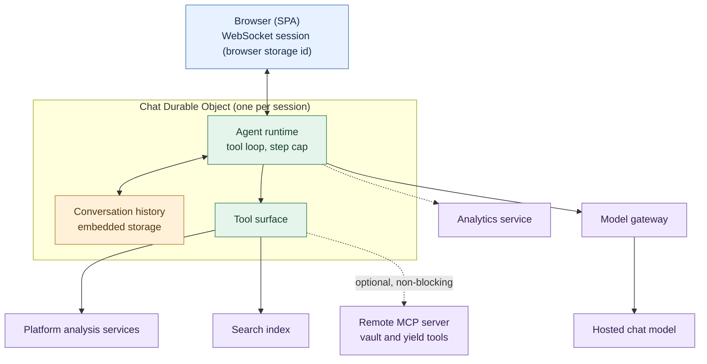
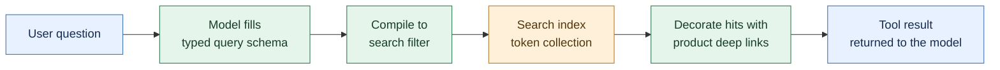
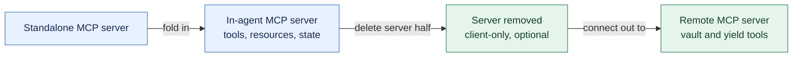
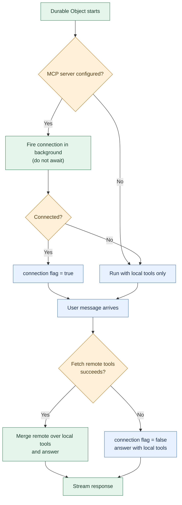
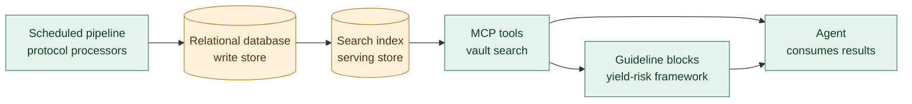
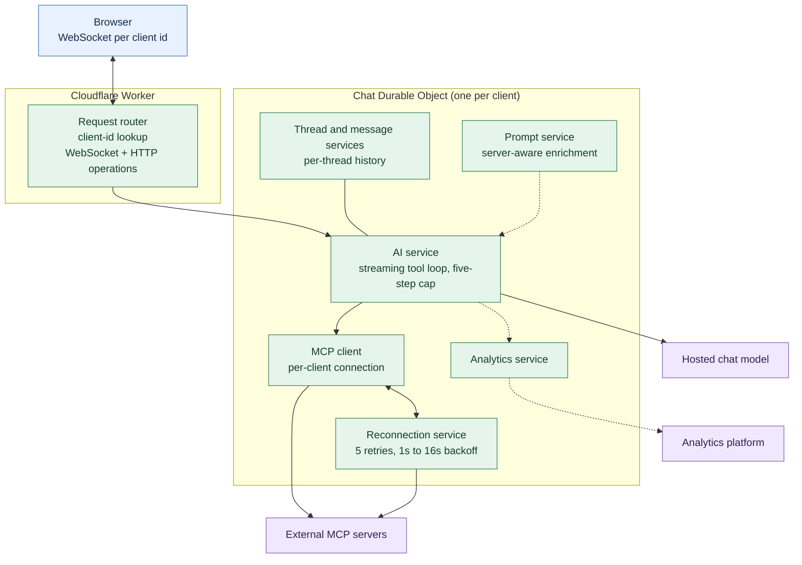
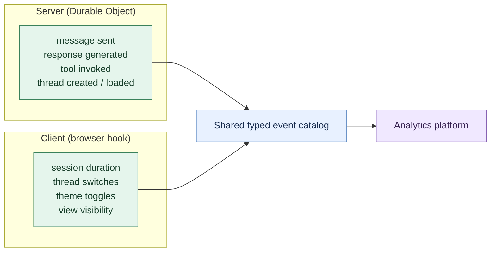

Albert is the AI assistant inside a DeFi analytics terminal. Users ask it about tokens, wallets, portfolios and DeFi vaults, and it answers by calling the platform's own analysis services, a search index, and, when one is configured, a remote MCP server of vault and yield tools.

The interesting engineering in a product like this is rarely the model call. It is the tool layer: which operations the agent can perform, where those operations live, what happens when one of them is unreachable, and how all of it survives contact with real users.

Albert's tool layer went through three shapes. It started as a single-session chat agent whose tools ran in-process, calling the platform's analysis services and search index. The tools then moved outward: first into a server hosted inside the agent, then to a dedicated MCP server that grew into its own data platform. Finally the agent itself was rearchitected into a multi-tenant platform with per-client isolation, threads, and a self-healing MCP connection.

This article follows the tool layer through all three, and the failure modes each version surfaced.

## What Albert is

The product is a chat assistant embedded in a DeFi analytics terminal. A user can ask what a token is, whether an address looks risky, what a set of vaults yields, or what the market is saying about a protocol. The agent is expected to answer from live platform data rather than from the model's memory.

That requirement turns the agent into an orchestration problem. The workloads do not all want the same thing from the model:

|Workload|What it produces|Primary constraint|
|---|---|---|
|Token analysis|A structured summary of a token's on-chain and market profile|Factual grounding|
|Address analysis|A risk and activity read on a wallet|Correctness and tone|
|Structured search|Tokens matching a market or liquidity query|Schema validity and latency|
|Feed search|Market-wide context from platform content|Relevance|
|Vault and yield research|Vault comparisons, risk and yield assessment|Accuracy and a defensible risk framing|

The last row is where the architecture kept shifting. Token, address and feed lookups all live inside the platform's own services. Vault and yield data lived, and eventually grew, somewhere else entirely.

## The single-session architecture

The first version is small enough to describe in a paragraph: one Cloudflare Worker, one storage-backed Durable Object per browser session, and one LLM call path.

A browser session gets a UUID that persists in browser storage. That UUID names a Durable Object, Cloudflare's single-threaded, stateful primitive, and the browser holds a WebSocket open to it. Inside the object, the agent runtime streams a chat completion from a hosted model through a model gateway, keeps the conversation in the object's embedded store, merges in tool results, and streams tokens back over the same socket.



Two decisions in that diagram carried forward into everything that followed. The agent is a *stateful object per session* rather than a stateless request handler, so the conversation is simply there when the next message arrives. And the tools are resolved at the object, so the feature surface and the tool surface can evolve without touching the transport.

The agentic loop is capped at ten steps, so a confused model cannot call tools indefinitely.

## The local tool surface, and the model as a query planner

The first version had four tools, three of which were thin wrappers over platform endpoints: token analysis, address analysis, and a market feed search. The fourth is the one worth dwelling on.

The token-search tool does not take a search string and forward it. It hands the model a typed schema covering chain, market cap, liquidity, volume-to-market-cap ratio, authenticity score, holders, stablecoin flag, price change and other dimensions, plus sort fields. The model fills that schema in as structured output, and the code compiles it into a search filter.

A request for "stablecoins with at least a million in market cap, ranked by token ranking" becomes something the model expresses as a typed query and the code serializes toward a filter like:

```
marketcap:>=1000000 && stablecoin:=true
```

Results are capped at ten per page and decorated with a deep link back into the product, so a follow-up click lands on the exact token rather than a search box.



This is a small pattern with a large payoff: the model does the part it is good at, turning a fuzzy request into structured intent. The code does the part it is good at, producing a correct, bounded query. The schema is the contract, and a malformed query fails validation before it ever reaches the index.

## Where do the tools live?

The vault and yield tools were the source of the architectural question. The answer changed twice.

The first answer was to build a standalone MCP server. It was a genuinely complete MCP implementation, with session management, tool registration and resources. It was then folded into the agent process itself as an in-agent MCP server, with tools for advanced token search and personalized recommendations, resources exposing session state and preferences, prompts for system and token analysis, and two state managers: one capping history at fifty entries, another inferring a user's risk tolerance from the market caps of the tokens they asked about (a minimum market cap above a billion reads as "low risk", a maximum under a hundred million as "high").

The second answer was to delete the server half entirely and go client-only.



Read as churn, that looks like thrash. Read as convergence, it is a clean lesson: a chat application that wants to expose tools should call out to the systems that own the data, not become one of them. Hosting vault-data tools inside the agent meant the agent had to own tool semantics, session state, and preference inference that had nothing to do with chatting. Once those responsibilities moved to a dedicated server, the agent shrank to what it should be: one object that streams answers and calls tools it does not own.

That shape, one agent reaching out to a remote tool server, is the one the next design kept. The build-and-remove cycles were not indecision so much as the cost of discovering, by building, where the boundary should sit.

## Failing quietly: the non-blocking MCP connection

Going client-only introduced a new requirement. If the vault tools live on a remote server, the agent has to stay useful when that server is slow, broken, or not configured at all. A DeFi assistant that throws an exception because an optional tool endpoint is down is worse than one that answers a narrower question.

The client integration was built around one rule: the connection to the MCP server must never block or break the chat.

On Durable Object start, the agent fires the connection attempt without awaiting it. A connection flag records whether the server came up. On every user message, the agent tries to fetch the remote tools inside an error guard; if that fetch throws, because the server went away between messages, the flag flips off and the agent continues with just its local tools.



The trade-off is visible in the same diagram. The flag never recovers within a Durable Object's lifetime: a single failed tool fetch disables remote tools until the object restarts. That is deliberate, because a broken server is more likely to stay broken than to heal between two messages, but it is a blunt instrument, and it is one of the things the next design fixed.

There is a second, subtler mismatch worth naming. The agent's system prompt advertises the remote vault and yield tools, because the model needs to know they might exist. When the MCP server is unset, the model is told about tools it cannot call, and some fraction of requests produce a failed tool attempt before the model falls back to local tools. A single prompt cannot be both "know these tools exist" and "never mention them if unset", so the graceful-degradation path includes tolerating a few doomed calls rather than pretending they cannot happen.

## The data server on the other end

Eventually the vault and yield tools lived on a dedicated MCP server, the platform that turns raw DeFi data into the vault, protocol, yield and wallet answers Albert needs. Understanding it matters here because it shows what the agent's tool layer was actually reaching for.

That server runs a scheduled pipeline: it scans multiple DeFi protocols for vaults, collects metrics, pulls security scores, and merges everything into a relational database as the write store and a search index as the serving store the tools query. It exposes ten tools to MCP clients: vault search, yield analysis, historical data, protocol and token search, top yields, risk analysis, and three wallet tools (portfolio, positions and top positions).

Two design choices there are worth borrowing for any tool layer aimed at an agent.

**The schema is the prompt.** Vault search accepts dozens of flattened filters, each carrying a description annotation. Those descriptions are not documentation for humans; they are how the model learns what a parameter means and how to use it. Input schemas designed for an LLM are a form of prompt engineering that travels with the tool.

**The response can coach.** When a result carries a risk rating, the server appends a guidelines block as a second content part: a yield-versus-risk framework (below 5% yields "may not justify the risk", 5% to 10% conservative, 10% to 20% medium, 20% to 40% high, above 40% extreme) plus short chain and protocol context. Instead of hoping the system prompt taught the model to frame risk well, the tool teaches it at the moment of the answer.



The split between a write store and a separate serving store is a familiar one, and it has a familiar debugging consequence: a stale index shows up as wrong tool results while the database looks perfectly healthy. When the agent gives an odd answer, the merge stage is the first place to look.

## From one session to many tenants

The first design assumed one session, one browser, one conversation. The next design assumed the opposite: many clients, each with several concurrent threads, some of them white-labelled for different product surfaces.

The load-bearing change is small to state and large in effect. Instead of a Durable Object per browser session, the platform creates **one Durable Object per client**, using a deterministic client-id lookup. Every thread, message, MCP connection and WebSocket for that client lives inside its own object, so isolation is a property of placement rather than something the application code has to enforce.

Thread management moved to HTTP against the same object. Listing, creating, loading, updating and deleting threads are HTTP requests routed to the client's object; the chat itself stays on the WebSocket. A message carries its thread identifier, so switching threads does not require reconnecting.



Three fixes from the first design show up here.

The non-blocking MCP connection became a **reconnection service**: proactive health checks before tool execution, reactive detection of connection-error patterns, and recovery with five retries on an exponential 1-second to 16-second backoff against persisted server configuration. The permanent flag-off from the first design is gone; a dropped connection now heals.

MCP tool results are **truncated to 50,000 characters** before they reach the model. That number is not arbitrary: an untruncated tool response once overflowed the context window and produced an empty answer with an unknown finish reason, which looks like a model failure but is actually a plumbing failure.

And the multi-step loop is explicit: a five-step cap. The agent framework defaults to a single step, which means a tool "works" but its result never reaches the answer, a failure mode that is easy to ship precisely because the tool call itself succeeds.

The prompt layer also grew a notion of where the tools came from. A local service classifies the connected MCP server and appends server-specific guidance to the system prompt, so a filesystem server and a DeFi data server can each get instructions appropriate to what they expose, the same "teach the model at the right moment" idea as the guidelines blocks, moved up to the system-prompt level.

## Instrumenting the agent

An agent that calls tools, streams tokens and reconnects on failure is hard to reason about from logs alone. The platform instruments it from two vantage points at once.

The **server side** emits events from inside the Durable Object: message sent, AI response generated, tool invoked, thread created, thread loaded. These are the ground truth for what the AI actually did. The **client side** emits from a client-side hook: session start and duration, message submissions, thread switches, theme toggles, whether the conversation list was visible. These describe what the user experienced.

Both halves share one typed event catalog, so an event name cannot drift between them.



The instrumentation was added without disturbing the streaming path: the server call sites hook into the existing request lifecycle through a lazily created service, so analytics opens no new connections, adds no per-request setup, and degrades to a no-op when the key is absent. For a tool-using agent, this is the difference between "the model got worse" and "the MCP server stopped returning data": two failures that look identical from the outside and completely different in the event stream.

## What stayed stable, and what it cost

Across all three shapes, the pieces that held still were the ones that were never really about the model.

**The agent stayed a stateful object.** One Durable Object per session became one per client, but the idea that a conversation is state and state belongs in the object that serves it never changed.

**The tools stayed behind an interface.** Whether a tool was a local function or a remote MCP endpoint, feature code called a named operation. Moving the vault tools to a dedicated server was a change of address, not a change of contract.

**The model stayed a planner, not a database.** It fills typed schemas; the code turns them into queries. That separation is what keeps the answers bounded and the index honest.

**Grounding stayed the point.** Albert is only useful because it answers from live platform data. Every architectural decision above is downstream of that.

The costs were just as durable.

**MCP's abstractions leak into the tool layer.** Remote tool schemas carry internal symbols that the framework uses to detect a valid schema; reconstructing a tool object, the intuitive way to wrap or instrument it, destroys those symbols and fails with an opaque type error. The fix is to spread the original tool and wrap only its execution, but the lesson is that an agent's tool wrapper is coupled to framework internals, not just to the tool's interface.

**Optional dependencies still need a policy.** The first design's flag-off approach kept the chat alive but left remote tools dead until restart. Graceful degradation has to decide not just whether an optional dependency failed, but how long the system waits before trying again.

**Truncation and step limits are correctness settings.** A context overflow and a single-step tool loop both present as model problems. In a tool-using agent, the odd failures are often in the plumbing around the model, not in the model.

**There is no authentication in this design.** Identity is an anonymous client ID in browser storage; the Durable Object is reachable by anyone who can name a client. That is fine for a public, low-stakes assistant, but it is a constraint that any move toward per-user data would have to confront directly rather than inherit.

## Closing thoughts

Albert's tool layer went through three shapes: local functions, a server hosted inside the agent, and a remote server the agent connects out to. Then the agent itself changed from one conversation to many, with isolation, threads, and a connection that heals.

The most useful lesson is not about any particular technology. It is that the question "where should the tools live?" has a real answer, and it is rarely "inside the thing that is talking to the user." A chat agent that hosts its own data tools ends up owning session state, preference inference and tool semantics that belong to the systems that actually hold the data. Connecting out keeps the agent small and lets the tool surface grow independently.

The second lesson is that an agent's reliability is mostly its failure policy. MCP connections drop, tool results overflow, optional servers go unconfigured, and a model told about a tool it cannot call will try to call it. None of those are model problems, and none of them are solved by a better prompt. They are solved by a transport that does not block, a wrapper that preserves what the framework needs, a result that gets truncated before it hurts, and a reconnect that knows how long to wait.

The model was the easy part to swap. The tool layer is what made the assistant worth using, and it is where all the interesting decisions actually lived.
